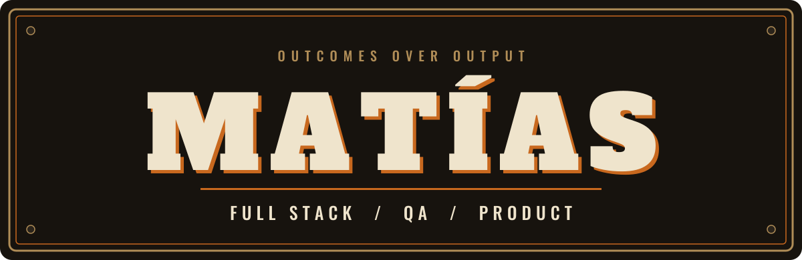

  

  Ex-firefighter. Classic and custom motorcycles. 
  I build software that holds up when it matters.

  <a href="PHILOSOPHY.md">How I work</a> &nbsp;·&nbsp;
  <a href="https://www.linkedin.com/in/matias-ivan-martin/">LinkedIn</a> &nbsp;·&nbsp;
  <a href="mailto:matiasivan.m@hotmail.com">Email</a>

---

## Three things to know

**I was a firefighter.** It taught me to stay calm under pressure, communicate clearly, own my part, and trust the team next to me. I still work that way.

**I ride classic and custom bikes.** Neo-retro is a philosophy to me: functional, intentional, with character, and no unnecessary noise. I try to build software the same way.

**I test like a QA, build like a developer, prioritize like a PO.** I'm most useful where code, quality, and product decisions meet.

---

## Results

Each project is told as a decision and what came out of it.

### PMS · Property Management System

| | |
|---|---|
| **Problem** | [One sentence: what was slow, error-prone, or manual before this existed.] |
| **Decision** | [One sentence: the key call you made, and what you chose not to do.] |
| **Result** | [A number: hours saved per week, errors avoided, flows automated.] |

`Data modeling` `Roles and permissions` `Backoffice workflows`

### Motorcycle community platform

| | |
|---|---|
| **Problem** | [One sentence: how riders find rides and safety information today.] |
| **Decision** | [One sentence: what you chose to build first and why.] |
| **Result** | [A number or milestone: users, rides listed, features shipped.] |

`Ride discovery` `Location-based` `Safety content`

---

## How I work

- Understand the problem behind the request.
- Define what "done" means before writing code.
- Make quality visible: tests are part of the build, not a final phase.
- Build for whoever maintains it next.

The longer version is in [PHILOSOPHY.md](PHILOSOPHY.md).

---

## Toolbox

| | |
|---|---|
| **Frontend** | React · Vue · JavaScript · HTML · CSS · Tailwind · Vuetify |
| **Backend** | Node.js · Express · PHP · Laravel · Symfony |
| **Databases** | PostgreSQL · MySQL · MariaDB · SQL Server |
| **QA** | Cypress · Jest · Selenium · Postman |
| **Workflow** | Git · Bash · Figma · Requirement analysis · Documentation |

---

## Recent activity

<!-- ACTIVITY:START -->
<!-- ACTIVITY:END -->

---

## Currently working on

- QA automation strategy
- Product ownership practices
- AI-assisted workflows
- Connecting business needs with technical execution

---

  <em>Quality, purpose, and a bit of gasoline in the veins.</em>

